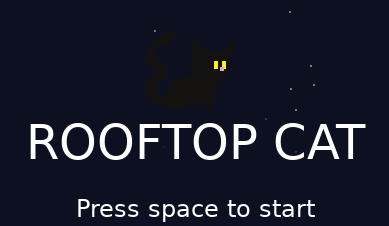

# Rooftop Cat 🐈‍⬛🎃

**[▶ Play in your browser](https://dogod3814t.github.io/rooftop-cat/)**

Rooftop Cat is a very self-explanatory game: a cat on a rooftop. But it is a far more
complex game than that. It contains revolutionary mechanics like *jumping* (take that,
Dark Souls), a broomstick I will make an actual sprite for one day, and a very goofy cat.

Made in one weekend for Hack Club Terra, in a language I'd never touched before Friday.
week 2 way more familiar still dont understand why they named this love but i love you for reading the READ ME 

## Running commentary
I though I should improve my general read me by going through all my design step for this project so basically first of all if you couldnt tell lots of inspiration was taken from general running games like the dino game and a couple of other i like too think of this game as kinda like the dino game but with extra steps and since this hackclub event alows you to contuine you each week my goal is too see how far i can push this concept adding bosses and powerup wasa good start but i want too truly overengineer this concept really rich backgrounds intresting desgin choices progression like a roguelike may be fun to implement or something else mostly this is just gonna be me exploring not only LOVE(I dont know how to do the weird thing they did with the o) for the first time but gamedev in general and i want too go as hard as possible

## 2.0 Update time get yo paws in the air cause new features are upon us 
-we got bosses two new vile enmies to fight the witch who can throw potions and apparently hates dogs named toto so at least thats something you both can agree on you can defeat her by slamming into her with your broomstick like quidditch

## And the bat he is a chubbed up version of regular bats and throws his body at you you can defeat him be jumping on his head like a goomba since our portagonist Mr Cat canonically weighs 5 tons and yes that is literally true thats why he plluments so fast off the skyscraper

## Graphical DoWnGrAdE 
yes we have lost pixels how scary no but to fit the aestetic for this week it has to be old thus why there is terminals everywhere and crt shading on the screen but it does look quite nice also it wasnt high quality to begin with and there is no assets in this game anyway except for jhon cat

## Cooler set
now we got some shiny windows smoking chimmneys if your lucky you might see a shooting star and yes i will actually make assets for the buildings eventually its jsut rather annoying too do cause it dont count for hackatime

## Sounds
Sounds are now added and I excpet geoff keighlye to give me best game audio of the year cause its heat 

## Bugs encountered: 
lets go over bugs this week was honestly really bad in that case i had so many gamebreakking and hard to find ones so first off lets talk about ends so lua is very picky about ends and that basically screwed me voer like a million times i contantly break it by inserting a function forgetting to put in a end then getting sad looking for the spot where i could have missed a end not finding it then compliaing to people who actually are like 5x my skill level in lua and them finding it in 5 seconds thats msotly been my process for this week 

## Stats 
As of now 1,000 ish code lines are in there whcih is triple from last week meaning we are defintley on track too catch up to gta 6 and also i now seprated up my bosses and other elements into seprate files for organization cause apparently walkatime does not count scrolling through your vscode document looking for the one little scrap of broken code as work they are sperated into the main file and two diffrent ones for each boss with one config file that does next too nothing besides the high scores that i should probably delete and the sound file for all the funny noises.
i commit pretty frequently whenver i feel like work has been done i have doen it around 51 times  and the number of ends i forgot to place then had to redo is probably up in the triple digits at this point 

##Controls:
Space, yes space very complicated, you can control how far you jump by holding it also avoiding hitting bats chimneys falling off the roof or crashing the game due to performance issues its like 500 lines of code so if you do that i will be impressed 

The brooms are a power up its like a double jump and also uses space woah see told you it was easy 

PUMPKINS yes by far the most important also easiest to draw Halloween themed item touch them to collect them
if you get 100 I will personaly reward you with naming the cat

##What was built 

so overall the game has a pretty decent chunk of features procedural world, powerup and collectible, 2 obstacles, a cool background and a awesome cat

##How to run 
you got to get some love not actual love thats for losers but the coding lanuage love artifical is better than nothing should be their tagline but it aint you can find it at (https://love2d.org) or grabbing it from you repo of choice you could really build from source if you wanted too and have a fancier computer than i

##What I learned
Basically all my experience with coding has been server work specfically with ubuntu open and zima os and that was all in C++ so this was my first run at Lua but its been good its pretty easy to learn their bug searching tool is excellent and while i did have some tripups like the random excessive use of love for functions its been pretty good with not too many bugs

##Credits
Cat sprites are the [Cat Sprite Pack](https://julesleech.itch.io/cat-sprite-pack) by Jules. I am working on adapting them too be my own but this was a helpful starter
Built with [LÖVE](https://love2d.org) 
claude was used for intial learning but past my intial square on screen all my work
New font VT323 cool terminal thing i used for all the terminals you can find it at https://fonts.google.com/specimen/VT323
Thanks for looking at the read me much appreicate very wow for your looks

