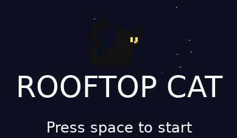

# Rooftop Cat 🐈‍⬛🎃

**[▶ Play in your browser](https://dogod3814t.github.io/rooftop-cat/)**

Rooftop Cat is a very self-explanatory game: a cat on a rooftop. But it is a far more
complex game than that. It contains revolutionary mechanics like *jumping* (take that,
Dark Souls), a broomstick I will make an actual sprite for one day, and a very goofy cat.

Made in one weekend for Hack Club Terra, in a language I'd never touched before Friday.

##Controls:
Space, yes space very complicated, you can control how far you jump by holding it also avoiding hitting bats chimneys falling off the roof or crashing the game due to performance issues its like 500 lines of code so if you do that i will be impressed 

The brooms are a power up its like a double jump and also uses space woah see told you it was easy 

PUMPKINS yes by far the most important also easiest to draw Halloween themed item touch them to collect them
if you get 100 I will personaly reward you with naming the cat

##What was built 

so overall the game has a pretty decent chunk of features procedural world, powerup and collectible, 2 obstacles, a cool background and a awesome cat

##How to run 
you got to get some love not actual love thats for losers but the coding lanuage love artifical is better than nothing should be their tagline but it aint you can find it at (https://love2d.org) or grabbing it from you repo of choice you could really build from source if you wanted too and have a fancier computer than i

##What I learned
Basically all my experience with coding has been server work specfically with ubuntu open and zima os and that was all in C++ so this was my first run at Lua but its been good its pretty easy to learn their bug searching tool is excellent and while i did have some tripups like the random excessive use of love for functions its been pretty good with not too many bugs

##Credits
Cat sprites are the [Cat Sprite Pack](https://julesleech.itch.io/cat-sprite-pack) by Jules. I am working on adapting them too be my own but this was a helpful starter
Built with [LÖVE](https://love2d.org) 
claude was used for intial learning but past my intial square on screen all my work
Thanks for looking at the read me much appreicate very wow for your looks